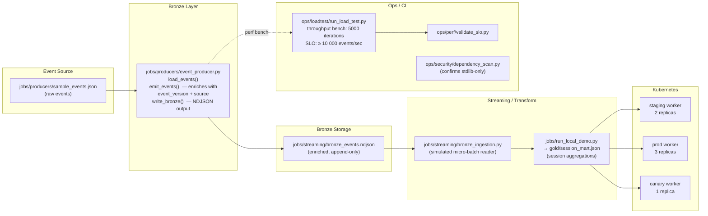
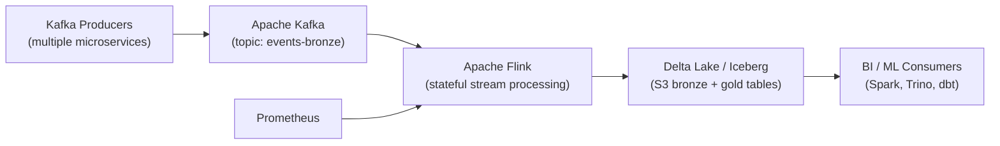

# Architecture — Real-Time Data Lakehouse

## Overview

The Real-Time Data Lakehouse simulates a Lambda-architecture streaming pipeline: a producer enriches raw events and emits them to a bronze NDJSON layer; a streaming job ingests bronze events; a gold transform computes session-level aggregations. The entire pipeline runs with Python stdlib only — no Kafka, Spark, or Flink dependency in the demo.

## Component Diagram



## Data Flow

1. **Ingest** — `load_events()` reads raw JSON events from `sample_events.json`
2. **Enrich** — `emit_events()` adds `event_version: "1.0"` and `source: "sample-producer"` to every record
3. **Bronze write** — `write_bronze()` serialises enriched events as newline-delimited JSON (NDJSON) — the append-only bronze layer
4. **Streaming read** — `bronze_ingestion.py` reads bronze NDJSON in micro-batches (simulated)
5. **Gold transform** — Session aggregations (session_id → event counts, duration, event types) written to `gold/session_mart.json`
6. **Quality gate** — Throughput benchmark must sustain ≥ 10 000 events/sec in CI

## Layer Semantics

| Layer  | Format | Write mode        | Purpose                                        |
| ------ | ------ | ----------------- | ---------------------------------------------- |
| Bronze | NDJSON | Append-only       | Raw enriched events, immutable record of truth |
| Gold   | JSON   | Overwrite per run | Business-level session aggregations            |

## Key Design Decisions

| Decision               | Rationale                                                                                    |
| ---------------------- | -------------------------------------------------------------------------------------------- |
| NDJSON for bronze      | Row-level streaming semantics, compatible with real Delta Lake/Iceberg without schema change |
| Enrichment at producer | Schema versioning + lineage tracking without touching downstream consumers                   |
| Stdlib-only            | Zero-dependency portability; swap producers for Kafka, bronze for S3+Delta in prod           |
| Throughput SLO in CI   | Catches regressions in hot-path code (emit_events / write_bronze) before merge               |

## Production Architecture (Target)



## Directory Map

```
real-time-data-lakehouse/
├── jobs/
│   ├── producers/
│   │   ├── event_producer.py    # load / enrich / write
│   │   └── sample_events.json
│   ├── streaming/
│   │   └── bronze_ingestion.py  # micro-batch reader
│   ├── run_local_demo.py        # end-to-end local demo
│   └── tests/
├── deploy/k8s/
│   ├── staging/ prod/ canary/
├── ops/
│   ├── alerts/ loadtest/ perf/ runbooks/ security/
└── .github/workflows/ci.yml
```
